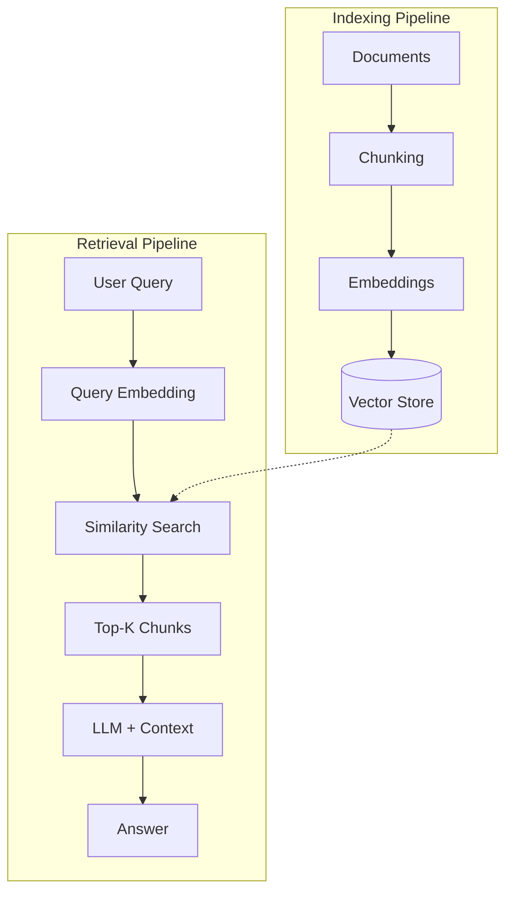

# 03 - RAG Agent

Build a document Q&A agent using Retrieval-Augmented Generation (RAG).

## What You'll Learn
- **Document Chunking Strategies**: Breaking down large documents into manageable pieces for better retrieval.
- **Text Embedding**: Converting text into high-dimensional vectors using `sentence-transformers`.
- **Vector Similarity Search**: Storing and querying high-dimensional data efficiently with `ChromaDB`.
- **Context Augmentation**: Enhancing LLM prompts with relevant retrieved context to reduce hallucinations.

## Architecture


## Quick Start
1. **Install Dependencies**:
   ```bash
   pip install -r requirements.txt
   ```
2. **Prepare Documents**:
   ```bash
   mkdir -p docs
   echo "RAG stands for Retrieval-Augmented Generation. It combines retrieval with text generation." > docs/sample.txt
   ```
3. **Run the Agent**:
   ```bash
   python main.py
   ```

## How It Works
The RAG agent operates in two main phases:
1. **Indexing**: Documents are read, split into smaller chunks (to stay within LLM context limits), converted into vector embeddings, and stored in a vector database.
2. **Retrieval & Generation**: When a user asks a question, the system searches the vector database for the most relevant document chunks. These chunks are then prepended to the user's prompt, providing the LLM with the specific facts needed to answer the query accurately.

## Key Concepts
- **RAG**: A technique that grants LLMs access to external, private, or real-time data without retraining.
- **Embeddings**: Numerical representations of text that capture semantic meaning.
- **Vector Databases**: Specialized databases designed for efficient similarity searching (e.g., ChromaDB, Pinecone).
- **Semantic Search**: Finding information based on meaning rather than just keyword matching.
- **Chunking**: The process of dividing text into smaller, meaningful segments to optimize retrieval precision.
