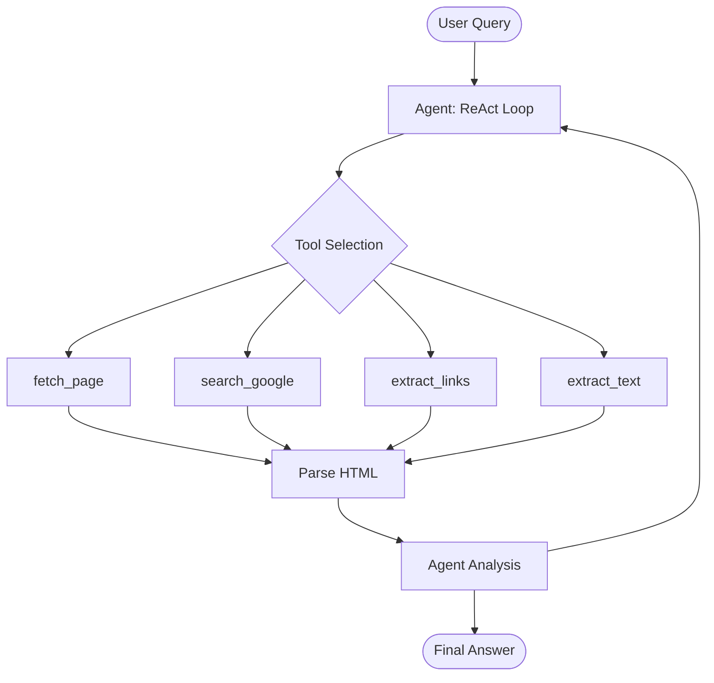

# 04 - Web Browsing Agent

Build an AI agent that navigates the web to find answers.

## What You'll Learn
- Web scraping with `requests` and `BeautifulSoup`
- Building browsing tools (fetch, search, extract)
- Agent decision-making for web navigation
- Content extraction and summarization

## Architecture


## Quick Start
```bash
pip install -r requirements.txt
python main.py
```

## How It Works
The Web Browsing Agent uses a ReAct (Reason + Act) loop to navigate the internet. Instead of relying solely on its internal training data, the agent uses tools to search the live web, fetch specific pages, and extract relevant content. It parses HTML structure to identify useful text and links, allowing it to "click" through sites until it finds the information needed to satisfy the user's query.

## Key Concepts
- **Web Scraping**: Programmatically retrieving content from websites.
- **HTML Parsing**: Converting raw HTML into structured data for analysis.
- **Agent-Driven Browsing**: Giving an LLM the autonomy to decide which URLs to visit.
- **Content Extraction**: Identifying and isolating the core information from a noisy web page.

## Available Tools
- `fetch_page`: Downloads the raw HTML content of a given URL.
- `search_google`: Performs a search query and returns a list of result snippets and URLs.
- `extract_links`: Identifies all hyperlinks within a page to enable further navigation.
- `extract_text`: Strips HTML tags and boilerplate to return clean, readable content.
