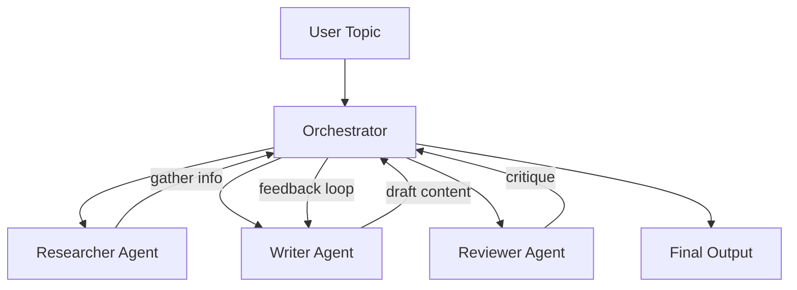

# 08 - Multi-Agent System

Build a team of cooperating AI agents that collaborate on research tasks.

## What You'll Learn
- Multi-agent orchestration patterns
- Role-based agent specialization (Researcher, Writer, Reviewer)
- Inter-agent communication and message passing
- Iterative refinement through feedback loops

## Architecture


## Quick Start
```bash
pip install -r requirements.txt
python main.py
```

## How It Works
The `orchestrator.py` manages a pipeline that coordinates three specialized agents. The `Orchestrator` handles the state transition between agents, passing the output of one as the context for the next. It also manages a revision loop where the Reviewer's feedback is used by the Writer to improve the draft until it meets quality standards or the maximum revision limit is reached.

## Key Concepts
- **Multi-Agent Systems (MAS):** Multiple independent agents working together to solve complex tasks that are difficult for a single LLM call to handle reliably.
- **Orchestration:** A central controller that manages the logic, state, and sequence of agent interactions.
- **Role Specialization:** Using specific system prompts to define clear boundaries and expertise for each agent.
- **Feedback Loops:** Implementing iterative cycles where agents critique and refine each other's work to reach a higher quality output.

## Agent Roles
- **Researcher:** Focused on gathering key facts, trends, and source leads for the given topic. Provides structured, bulleted research notes.
- **Writer:** Responsible for drafting clear, coherent technical content based on research notes and addressing specific reviewer feedback during revisions.
- **Reviewer:** Acts as a strict quality gate, evaluating clarity and accuracy. Returns structured JSON feedback including an approval status and a quality score.
