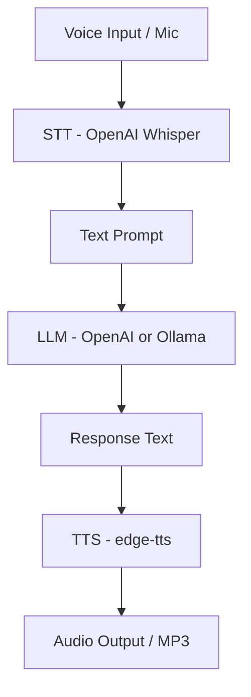

# 09 - Voice Agent

Build a speech-to-speech AI agent with STT and TTS.

## What You'll Learn
- **Speech-to-Text (STT)**: Converting spoken audio into text using OpenAI Whisper.
- **Text-to-Speech (TTS)**: Generating high-quality, natural-sounding speech with `edge-tts`.
- **Audio Pipeline Design**: Managing the flow from microphone input to audio playback.
- **Voice Interaction UX**: Handling latency and providing feedback during voice conversations.

## Architecture


## Quick Start

1. **Install dependencies**:
   ```bash
   pip install -r requirements.txt
   ```
   *Note: For full voice mode, you may also need `sounddevice` and `playsound` (system dependencies like `portaudio` might be required).*

2. **Set up Environment**:
   Ensure your `OPENAI_API_KEY` is set in your environment if using OpenAI.

3. **Run the agent**:
   ```bash
   # Default: Text mode (Type text, get audio response)
   python main.py

   # Full Voice mode (Record from mic, hear response)
   python main.py --voice
   ```

## How It Works
1. **Capture**: In voice mode, the agent records audio from your microphone using `sounddevice`.
2. **Transcribe**: The recorded audio is sent to the OpenAI Whisper API to be converted into text.
3. **Reason**: The transcribed text is sent to an LLM (configurable via `LLM_PROVIDER`) to generate a conversational response.
4. **Synthesize**: The assistant's text response is converted back into speech using the `edge-tts` library, which leverages Microsoft Edge's neural voices.
5. **Play**: The resulting MP3 is played back to the user.

## Key Concepts
- **Latency Management**: Voice agents require fast response times. This implementation uses efficient TTS and STT providers to minimize "dead air."
- **Audio Buffering**: Handling raw audio data and converting it into compatible formats (WAV/MP3) for APIs and playback.
- **Provider Flexibility**: Easily switch between local LLMs (Ollama) and cloud APIs (OpenAI) while keeping the voice interface consistent.

## Modes
- `--text`: (Default) Interactive REPL where you type your message. The assistant responds with text in the terminal and generates an MP3 file of the speech.
- `--voice`: Full hands-free experience. The agent listens for your voice, transcribes it, and plays the response audio automatically.
