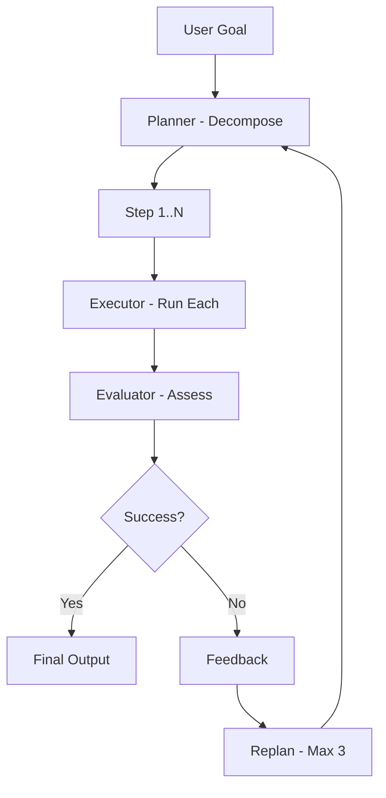

# 10 - Autonomous Agent

Build a self-planning agent that decomposes goals into executable steps.

## What You'll Learn
- **Goal Decomposition**: Breaking down high-level objectives into specific, actionable steps.
- **Plan-Execute-Evaluate Loops**: The core feedback loop of autonomous agents.
- **Self-Reflection and Replanning**: Using failure as feedback to iterate on a plan.
- **Autonomous Task Completion**: Building systems that work toward a goal without human intervention between steps.

## Architecture


## Quick Start

1. **Install dependencies**:
   ```bash
   pip install -r requirements.txt
   ```

2. **Run the agent**:
   ```bash
   python main.py
   ```

3. **Provide a goal**:
   Enter a high-level task for the agent to complete.
   ```text
   Goal> Create a 3-step guide for making the perfect cup of coffee.
   ```

## How It Works
- **Planner**: The Planner receives the user's goal and generates a structured plan (a list of discrete steps). If feedback is provided from a previous failed attempt, the Planner incorporates it to refine the new plan.
- **Executor**: The Executor takes each step of the plan and simulates the execution of that step. It returns the result of the action, which the agent collects.
- **Evaluator**: Once all steps are executed, the Evaluator looks at the original goal and the collective results. It decides if the goal was successfully met or if further iterations are needed.
- **Iteration**: The loop repeats up to a maximum number of times (default 3), allowing the agent to "think," "act," and "correct" itself autonomously.

## Key Concepts
- **Structured Planning**: Using LLMs to generate JSON-like plans that can be programmatically parsed and executed.
- **Closed-Loop Systems**: Unlike simple chatbots, autonomous agents verify their own work and adjust their behavior based on the outcome of their actions.
- **Context Management**: Passing the original goal and previous results through each stage of the loop to maintain state and coherence.

## Components
- **Planner**: Logic responsible for strategy and step generation.
- **Executor**: Logic responsible for performing the individual tasks in the plan.
- **Evaluator**: Logic responsible for quality control and success verification.
