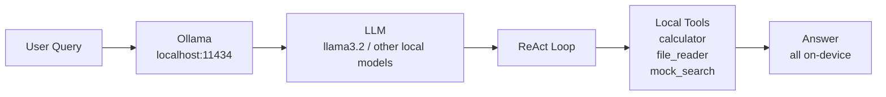

# 12 - Local LLM Agent

Build a fully offline AI agent — zero cloud dependency.

A local-first AI agent powered by Ollama, with **only 2 Python dependencies** (`requests` and `colorama`).

## What You'll Learn

- Running LLMs locally with Ollama
- Local tool calling
- Privacy-preserving AI
- Minimal dependency design

## Architecture



## Quick Start

1. Install Ollama: https://ollama.com/download
2. Pull a local model:
   ```bash
   ollama pull llama3.2
   ```
3. Install Python dependencies (**only 2**):
   ```bash
   pip install -r requirements.txt
   ```
4. Run the agent:
   ```bash
   python main.py
   ```

## How It Works

This project talks directly to Ollama's local API at `http://localhost:11434`, so model inference stays on your machine.

The agent follows a lightweight ReAct-style loop: the model reasons, chooses a local tool when needed, and returns a final response. No cloud APIs, no remote data transfer, and no heavyweight framework dependency.

## Key Concepts

- Local inference
- Ollama
- Privacy-first AI
- Edge computing

## Commands

- `/models` — list available local models
- `/switch` — switch the active model
- `/quit` — exit the agent

## Why Local?

- **Privacy:** prompts and data remain on-device
- **Cost:** no per-token cloud billing
- **Speed:** no network round trips for inference calls
- **Offline access:** works without internet once set up
